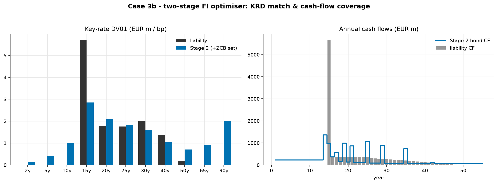
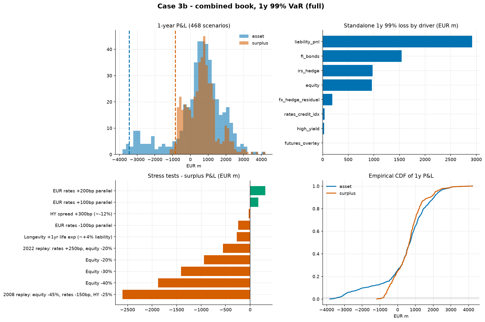
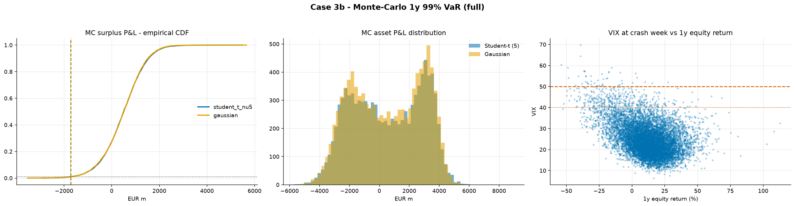

# Case 3b — All-Kanns: Life-insurance asset–liability management

**Financial Engineering · Group 2 · Final client presentation (38 pages)**

## Investment mandate
Design an implementable investment strategy for **All-Kanns**, a fictional life insurer with a single cohort of **100,000 policyholders**, all age 50, half male. Each already has **€50,000** invested, generating **€5.0bn of assets at inception**. Each pays another **€5,000 at the end of each of the next ten years**, equivalent to **€0.5bn annually** or €5bn of nominal contributions.

The insurer promises a **1.0% annual guaranteed rate**. After fifteen years, policyholders choose a lump sum or a lifetime pension, with a ten-year minimum payout guarantee. The presentation assumes **50% lump sum / 50% pension** as its base election scenario and no deaths during the first fifteen years.

The economic problem is **not** simply to maximize investment return. It is to protect contractual benefits, preserve liquidity at the election date and earn a surplus without making the guarantee dependent on risky-asset performance.

## Executive recommendation
The final group pitch proposes **two investment mandates on one balance sheet**:

| Sleeve | Funding | Objective | Main instruments |
| --- | --- | --- | --- |
| **Liability-Matching Portfolio (LMP)** | €5.0bn existing assets | Protect guaranteed benefit cash flows and interest-rate sensitivity | EUR sovereign / supranational / agency bonds, ultra-long maturities, zero-coupon bonds and receiver swaps |
| **Return-Seeking Portfolio (RSP)** | €0.5bn annual contributions over ten years | Grow surplus above the guarantee | Diversified investable equity indices with smaller high-yield, gold and EUR sleeves |

The presentation describes the RSP target as roughly **93% equities, 4% high yield, 2% gold and 1% EUR**, across fourteen indices. These are **strategic target weights**, not an independently verified current portfolio.

## Why the two-sleeve design matters
The LMP and RSP have different success criteria. The LMP is judged by its ability to meet the timing and sensitivity of **liability cash flows**, whereas the RSP is judged by long-horizon surplus generation **within a risk budget**. The proposed separation is intended to prevent short-term risky-asset losses from forcing sales of the assets dedicated to the guarantee. In practice, both sleeves remain on the same insurer balance sheet, so risk segregation is a **management design**, not legal isolation.

## Key results highlighted in the presentation
| Measure | Group presentation |
| --- | --- |
| Accumulated guaranteed value at year 15 | Approximately **€11.3bn** |
| Base-case year-15 lump-sum election | Approximately **€5.65bn** |
| Guaranteed liability PV (one model configuration) | Approximately **€6.41bn** |
| Liability duration (same configuration) | Approximately **20 years** |
| Median 15-year investment IRR | Approximately **6.0–6.5%**, depending on slide/model view |
| Receiver-IRS overlay | **€2.8bn at 15Y + €0.3bn at 30Y** |
| Hedged 1-year surplus VaR (presentation) | Approximately **€0.84–0.86bn**, with confidence/horizon labels varying by slide |
| Illustrative Solvency II ratio | Approximately **340%** |

**Interpretation:** these are results from different group model runs and presentation slides; they should **not** be forced into one reconciled snapshot. The IRR, risk and solvency numbers depend on deployment timing, election assumptions, hedge state and risk-model specification.

## End-to-end reproduced results

The canonical Case 3 implementation was run successfully from GitHub Actions with the matching course workbooks retrieved into an ephemeral runner. The optimizer, 0–100% policyholder election reruns, historical simulation, Monte Carlo, and final-presentation receiver-IRS overlay all completed successfully.

**Optimizer (two-stage cash-flow dedication + KRD shaping):** The expanded ZCB/ultra-long universe uses 25 instruments (7 zero-coupon, longest 94 years). Stage 2 reports duration 29.2 years, convexity 332, asset DV01 €14.6m/bp against liability €12.8m/bp, residual surplus DV01 gap −€1.8m/bp and zero PV external top-up. The optimizer's liability valuation is €6.41bn (duration 20.0 years).

**Integrated 1-year 99% risk engine:** This is a separate valuation configuration: assets €10.0bn, liability PV €6.81bn, economic surplus €3.19bn and funding ratio 1.47.

| Risk configuration | Asset VaR | Surplus VaR | Surplus ES |
|---|---:|---:|---:|
| Historical simulation, automatic equity-futures overlay (~13.8%) | €2.384bn | **€1.195bn** | €1.255bn |
| Historical simulation, 15Y/30Y receive-fixed IRS overlay, futures at 0% | €3.449bn | **€0.845bn** | €1.001bn |
| Monte Carlo, Student-t, no IRS (20,000 paths) | €2.284bn | **€1.803bn** | €1.923bn |
| Monte Carlo, Student-t, with IRS (10,000 paths) | €3.908bn | **€1.721bn** | €2.075bn |

The receiver-swap case uses €2.8bn at 15Y and €0.3bn at 30Y. Higher asset VaR under the IRS overlay is expected because receive-fixed swaps add duration to the asset book; the reported surplus VaR is the more decision-relevant liability-relative measure. The two Monte Carlo cases have different path counts and should not be interpreted as a controlled one-variable comparison.

**Policyholder election sensitivity:** the optimizer re-runs at 0%, 25%, 50%, 75% and 100% lump-sum election. At the 50/50 base case the optimizer liability PV is €6.41bn, duration about 20.0 years and year-15 lump liability about €5.65bn.

[Reproduced fixed-income optimization report](reproduced/fixed-income/REPORT.md) · [Election sensitivity](reproduced/elections/ELECTIONS_REPORT.md) · [HS receiver-IRS report](reproduced/risk/HS_REPORT_full_irs.md) · [Monte Carlo receiver-IRS report](reproduced/risk/MC_REPORT_mc_full_irs.md).

## Canonical model version

**This portfolio uses the later integrated Case 3 implementation from the shared GitHub repository**: `src/case3_model.py` for the risk and liability engine and `src/cashflow_match_v2.py` for the two-stage fixed-income optimizer. Earlier archived prototypes are not used as alternative headline models. The standalone mortality module remains a supporting, independently tested component, not a second ALM pipeline.

## Explore the full case
1. [Liabilities, pension elections and cash-flow timing](liability-modelling.md)
2. [Portfolio construction, fixed-income optimization and hedging](portfolio-and-hedging.md)
3. [Monte Carlo, risk budget, stress tests and solvency](risk-and-solvency.md)
4. [Investment recommendation, limitations and recruiter discussion](conclusions-and-limitations.md)

## Why this is a financial-engineering project
The group's analysis connects **actuarial cash flows**, **discount-curve construction**, **constrained optimization**, **duration/convexity and key-rate DV01**, **receiver interest-rate swaps**, **multi-asset return modelling**, **FX hedging**, **VaR and Expected Shortfall**, **policyholder elections** and **solvency constraints**.

A key analytical insight is that **minimizing asset-only VaR is not equivalent to minimizing insurance surplus risk**. Adding duration with a receiver swap may increase asset-value volatility while reducing the mismatch between assets and liabilities. For an insurer, the **funding ratio and surplus distribution** are often the more decision-relevant quantities.

## Original group charts

*Source: final group's Case 3 presentation assets — fixed-income cash-flow matching.*

*Source: final group's Case 3 presentation assets — portfolio allocation.*

*Source: final group's Case 3 presentation assets — modelled funding outcomes.*

*Source: final group's Case 3 presentation assets.*

[Inspect the model architecture, source code and result tables](IMPLEMENTATION.md).

## Acknowledgements

This was a collaborative Financial Engineering group project. Thanks to **Jonas and Kira** and the rest of the group for their contributions.

## Source and attribution
- Final group presentation: *Asset Management for the All-Kanns Life Insurance*, 38 pages.
- [Shared course repository: Case 3](https://github.com/benthebender/Financ-Engeneering/tree/main/Case%203), including models, Excel data, optimization outputs, VaR reports and charts.

This is a collaborative academic proposal for a fictional insurer, **not an audited insurance balance sheet or live investment mandate**.

[Back to main README](../README.md)
